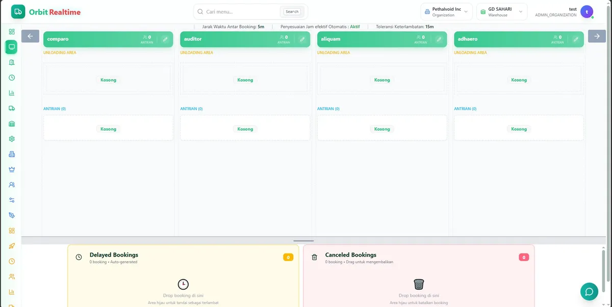
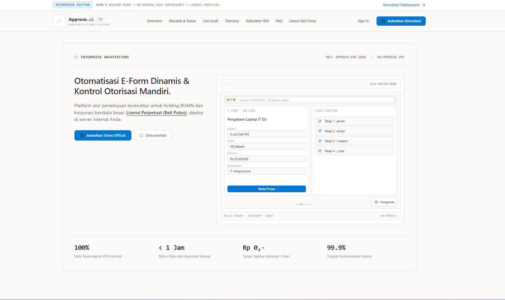
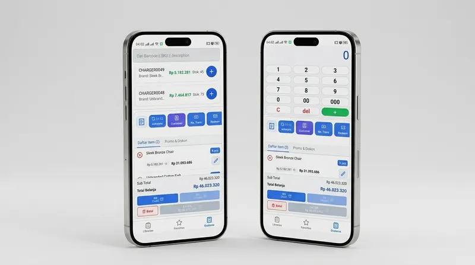
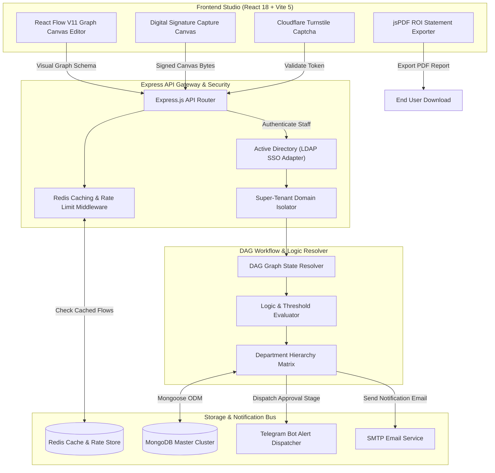
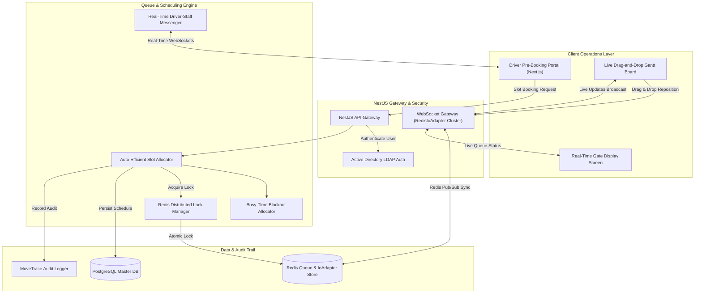
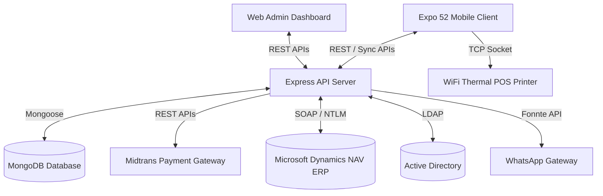
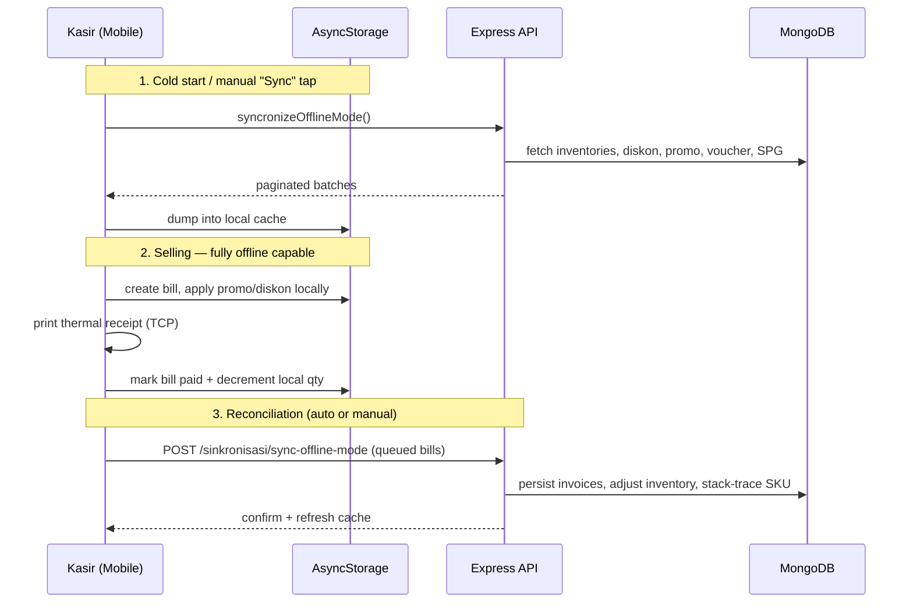
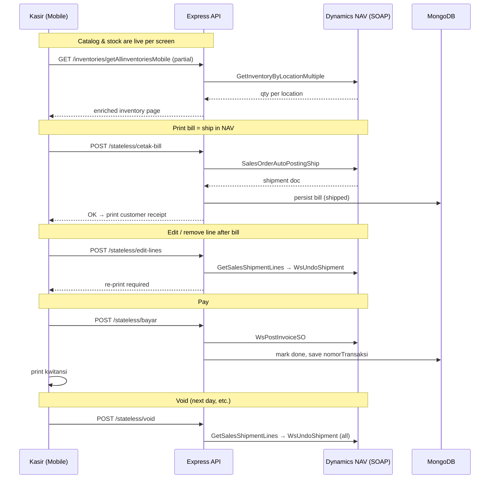
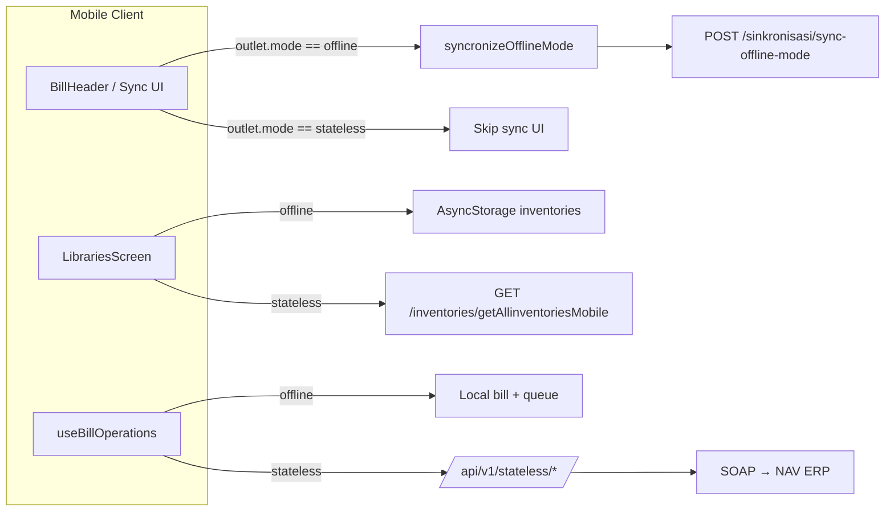

# Yafizham Batubara

**Backend / Applied AI Engineer**

Fullstack TypeScript / Node.js / NestJS / React + AI Agent Engineer (LLM tool-calling, RAG)

Jakarta, Indonesia · Open to worldwide remote; open to relocation with visa sponsorship

Backend and applied AI engineer who has built and maintained **15+ production applications** across logistics, sales, finance, and internal workflows at **PT Catur Sukses Internasional**. These systems support multiple tenants with custom role-based access control (RBAC) shaped around each business workflow. Core stack: **TypeScript, Node.js, NestJS, PostgreSQL, and Redis**, with React/Next.js frontends and framework-free LLM agents in Node.js and Python (custom orchestration loop, tool calling, RAG). Currently building an enterprise AI agent integrated with **Microsoft Dynamics NAV**.

**[Email me](mailto:yafizham@pethalvoid.com) · [LinkedIn](https://www.linkedin.com/in/muhammad-yafizham-batubara-b589051a9) · [Explore my repositories](https://github.com/Ham144?tab=repositories)**

## Technical skills

- **Backend & APIs:** TypeScript, Node.js, NestJS, Express.js, Python, FastAPI, REST APIs, WebSockets
- **Frontend & Mobile:** React, Next.js, React Native (Expo), React Flow
- **Data & Infrastructure:** PostgreSQL, MongoDB, Redis, Prisma, Docker, Linux VPS, Nginx, GitHub Actions, Cloudflare
- **AI & LLM:** Custom agent orchestration (tool-calling loop), OpenAI / Anthropic / Gemini / OpenRouter APIs, structured outputs, RAG, pgvector, Qdrant, Langfuse observability, eval sets, guardrails
- **Enterprise Integrations:** Microsoft Dynamics NAV (SOAP/NTLM), LDAP/Active Directory, Midtrans, WhatsApp, Telegram

## Experience

**PT Catur Sukses Internasional — Software Engineer** · Jakarta · Oct 2024 – Present

- Built MIDCSI System Hub, the shared Microsoft Dynamics NAV integration platform behind internal apps and external vendors, now adding an AI agent layer.
- Built and maintain 15+ production applications across logistics, sales, finance, and internal workflows, owning data model, permission rules, APIs, integrations, deployment, and support.
- Designed multi-tenant systems with custom RBAC shaped around each business workflow.
- Resolved high-concurrency warehouse scheduling conflicts with Redis caching/locking and optimized PostgreSQL queries.

## Selected projects

### 1. [MIDCSI System Hub — Shared ERP Integration Platform & AI Agent (Microsoft Dynamics NAV)](https://github.com/Ham144/ninth--sales-app-)
*Node.js, Express, MongoDB, Redis, SOAP/NTLM (httpntlm, xml2js), node-cron, JWT, LDAP, TOTP, OpenRouter LLMs, React 19 + Vite*
- Built the shared integration backend reused by internal apps (e.g. S-BIT Field Sales CRM) and external vendor companies, with an X-API-key management portal: scoped keys (full / public-catalog), expiry, and revocation.
- Wrapped Microsoft Dynamics NAV SOAP/NTLM services and engineered nightly cron batch sync of products, customers, and overdue receivables into MongoDB, with SHA-256 change hashing to skip unchanged records; live NAV sales-order status on demand.
- Delivered a central hub for 16 company apps with login via JWT, LDAP/Active Directory, and TOTP two-factor auth, plus centralized docs and release updates.
- **AI agent layer (in progress, beta):** tool-calling agent built from scratch with no framework: own tool routing over 10+ ERP tools, public and internal-staff personas, prompt-injection guardrails, per-tenant rate limits and daily budgets, audit logs, embedding retrieval, and a tool-selection eval set.

### 2. [Warehouse Queue Management System](https://github.com/Ham144/warehouse-queue-management-system)
*NestJS, PostgreSQL, Redis, Next.js, WebSockets*
- Booking and queue management across **12+ facilities**, **~2,500 bookings/month**, with no reported booking collisions.
- Redis distributed locks, Redis-backed WebSocket scaling, live drag-and-drop dock board, LDAP auth, audit logging.

### 3. [Super POS Mobile](https://github.com/Ham144/super-pos-mobile)
*React Native (Expo), Express.js, MongoDB, Dynamics NAV, Midtrans*
- Mobile POS for **40+ outlets and field reps**, **~15,000 transactions/month**, with no reported transaction loss.
- Offline-first sync and reconciliation, Dynamics NAV SOAP/NTLM shipping/invoicing flows, thermal printing, Midtrans payments.

### 4. [Approva — Approval Workflow Engine](https://approva-ai.hexadim.com/)
*Node.js, Express, MongoDB, React Flow, Redis, LDAP*
- Multi-level approval workflows: **800+ workflows/month** across **5+ departments**.
- DAG-based workflow resolver, visual graph editor, tenant isolation, Redis caching/rate limiting, Telegram and email notifications.

### 5. [BuktiScan — Multi-tenant Invoice Scan & CCTV Evidence System](https://github.com/Ham144/invoTrack)
*NestJS, Prisma, Socket.IO, FFmpeg, Astro + React, Electron*
- Multi-tenant logistics system: barcode invoice scans at cashier PCs automatically trigger CCTV (RTSP) recording, with clips auto-cut and synced to the backend.
- Electron desktop agent ([agent_bukti_scan](https://github.com/Ham144/agent_bukti_scan)) reads USB serial scanners and supports up to 6 scanners + 6 CCTV streams in parallel per workstation; admin dashboard for workstations, scanners, and scan logs.

### 6. [Field Sales CRM (S-BIT)](https://github.com/Ham144/field-sales-crm-sbit)
*React, Express.js, MongoDB, Leaflet, Dynamics NAV*
- Geofenced visit and reporting workflows for **50+ sales reps**, **~3,000 client visits/month**, with ERP synchronization.

These figures describe systems in use at my current employer; linked repositories provide implementation details where public source is available.

### Product screenshots

| Warehouse queue board | Approva workflow interface | Mobile POS checkout |
| :---: | :---: | :---: |
|  |  |  |

## AI and automation projects

- **[Aca](https://aca.pethalvoid.com/)** — WhatsApp AI customer-service assistant built around workflow automation and knowledge retrieval.
- **[Rachel](https://rachel.pethalvoid.com/)** — AI-assisted content production and distribution system. I work on its orchestration, infrastructure, and video rendering pipeline.

## System design

<strong>Approva — approval workflow engine</strong>

<strong>Warehouse Queue Management System — real-time scheduling</strong>

<strong>Super POS Mobile — ERP integration and offline/online flows</strong>

## How I work

I started most of these projects by designing and coding their foundations myself, from the data model and permission rules to APIs, integrations, deployment, and support. I now use AI tools to speed up implementation, while I remain responsible for architecture, code review, testing, and production behavior. I am most interested in remote backend and applied-AI roles where reliability and measurable business outcomes matter.

**Languages:** Bahasa Indonesia (Native) · English (IELTS General Training: Band 7.0)

**Contact:** [yafizham@pethalvoid.com](mailto:yafizham@pethalvoid.com)

