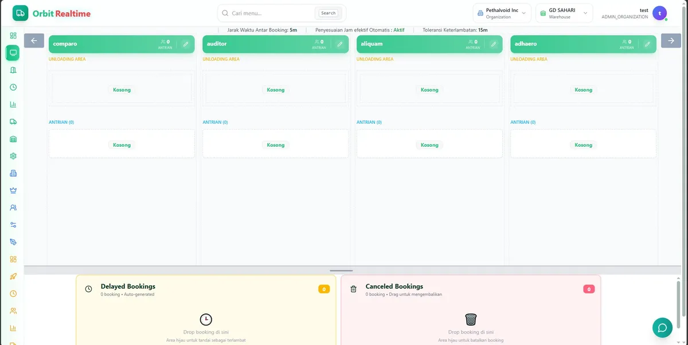
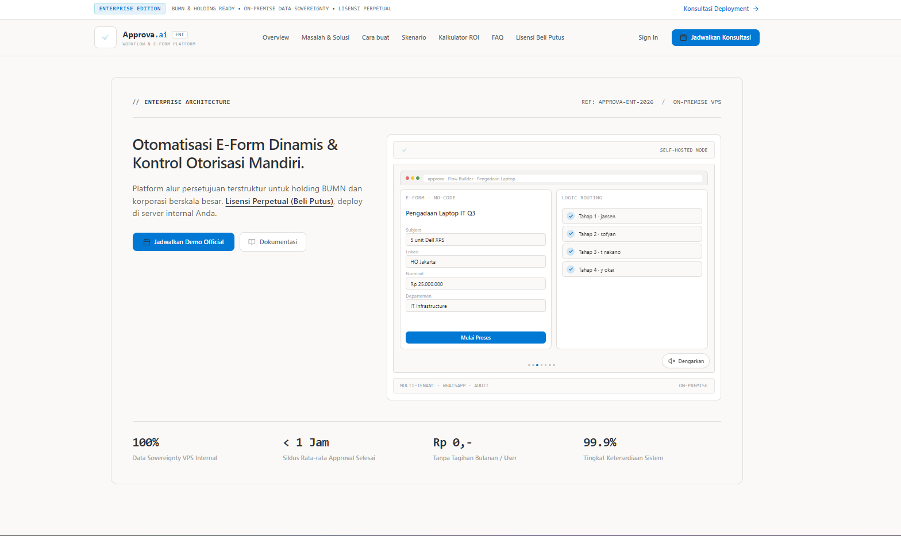
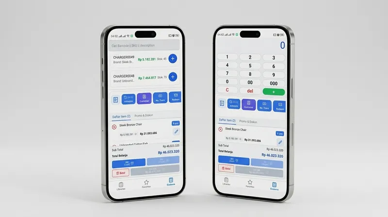
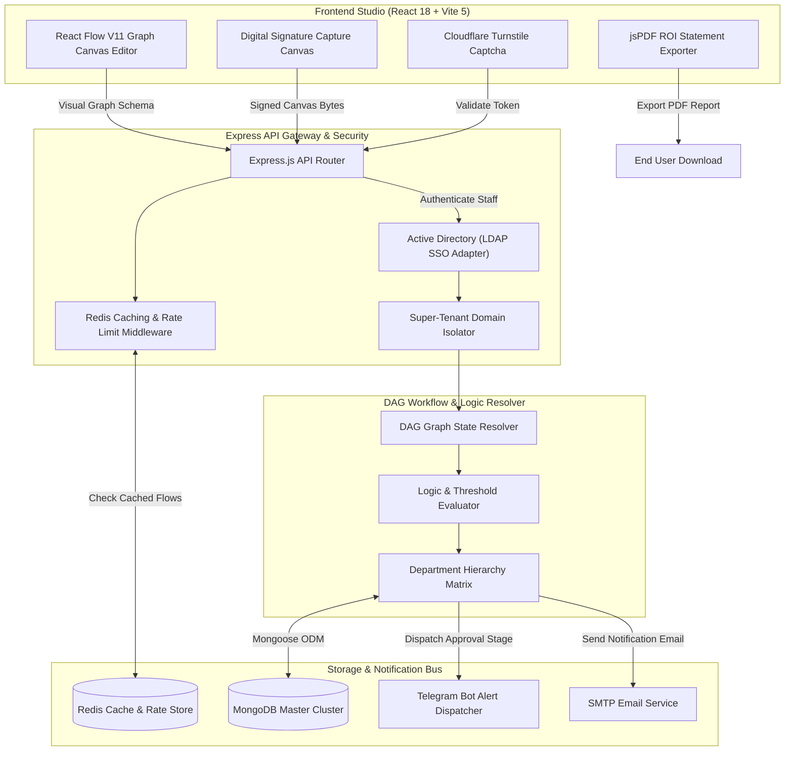
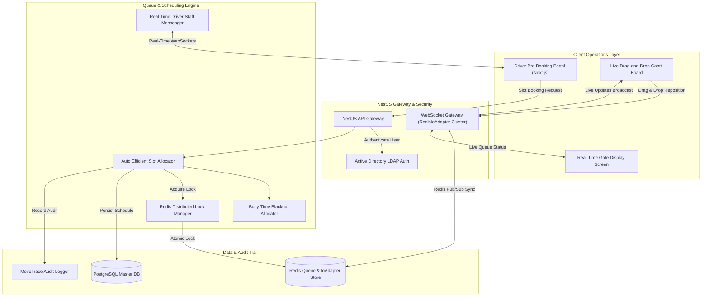
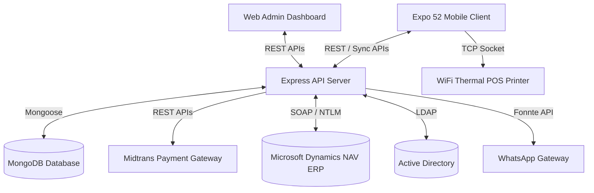
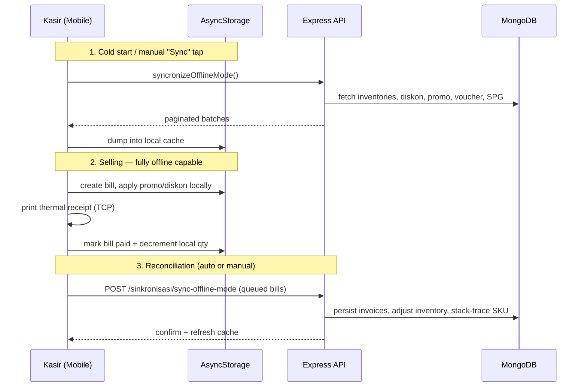
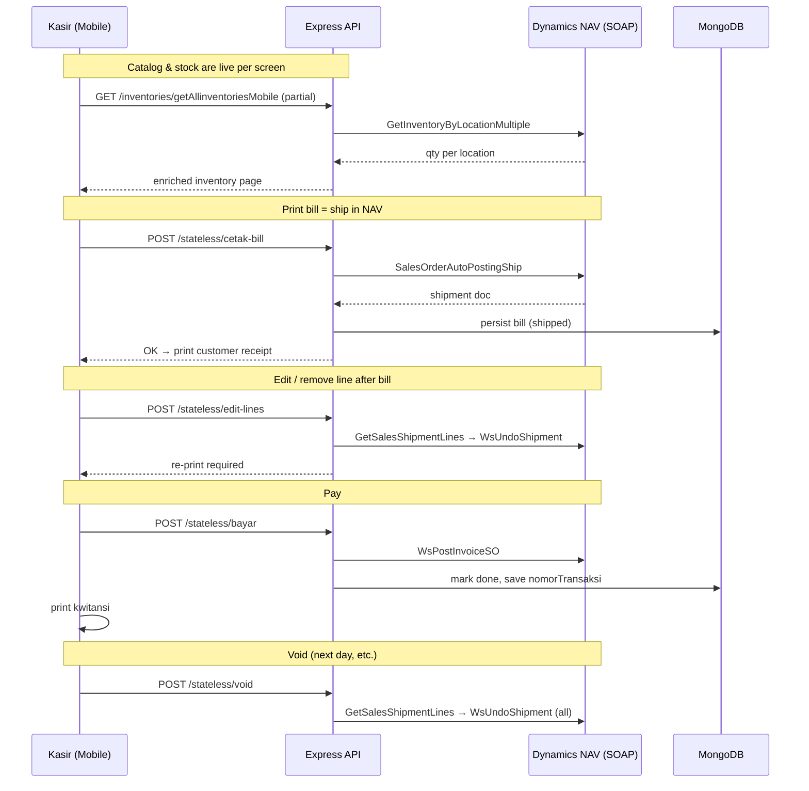
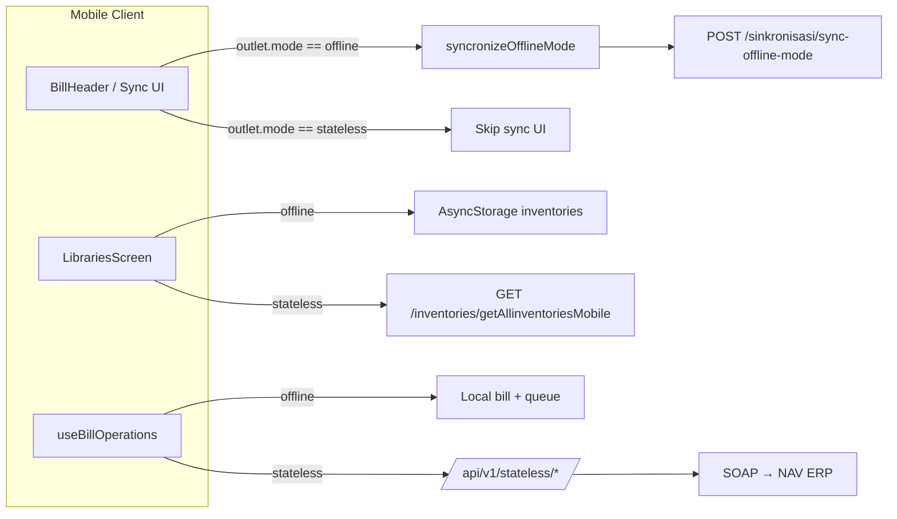

# Yafizham Batubara

**Backend Engineer · Applied AI Engineer · Enterprise Systems**

Jakarta, Indonesia · Open to worldwide remote roles and on-site relocation with visa sponsorship

I build software that teams use to run daily operations. At **PT Catur Sukses Internasional**, I have built and maintained **15+ production applications** across logistics, sales, finance, and internal workflows. These systems support multiple tenants and use custom role-based access control (RBAC) shaped around each business workflow. My core stack is **TypeScript, Node.js, NestJS, PostgreSQL, and Redis**. I also work on AI agents, LLM orchestration, and enterprise integrations.

**[Email me](mailto:yafizham@pethalvoid.com) · [LinkedIn](https://www.linkedin.com/in/muhammad-yafizham-batubara/) · [Explore my repositories](https://github.com/Ham144?tab=repositories)**

## Current focus: AI agent for Microsoft Dynamics NAV

I am building an enterprise chatbot that connects authenticated, persistent conversations to internal workflows and **Microsoft Dynamics NAV** through **SOAP/NTLM**. Its goal-oriented agent uses conversation context to support e-commerce customers, warehouse administrators, and telemarketing staff. The backend keeps ERP credentials and privileged operations server-side.

**In development:** a permission-aware **Retrieval-Augmented Generation (RAG)** pipeline over ERP data, using PostgreSQL for structured retrieval data and Redis as a planned retrieval/vector cache. It is intended to answer inventory and approval questions with current, authorized data. I do not present this pipeline as deployed or measured yet.

## Selected production work

| Project | What I built | Scale and outcome |
| --- | --- | --- |
| [Warehouse Queue Management System](https://github.com/Ham144/warehouse-queue-management-system) | Booking and queue management for warehouse operations | **12+ facilities**, **~2,500 bookings/month**, with no reported booking collisions |
| [Super POS Mobile](https://github.com/Ham144/super-pos-mobile) | Mobile point-of-sale workflows for outlets and field teams | **40+ outlets and field reps**, **~15,000 transactions/month**, with no reported transaction loss |
| [Approva](https://approva-ai.hexadim.com/) | Multi-level approval workflows for cross-department operations | **800+ workflows/month** across **5+ departments** |
| [Inventory Audit System](https://github.com/Ham144/inventory-audit-system) | Inventory counting and audit workflows | **100,000+ SKU line items/year** |
| [Field Sales CRM (S-BIT)](https://github.com/Ham144/field-sales-crm-sbit) | Geofenced visit and reporting workflows for field sales | **50+ sales reps**, **~3,000 client visits/month** |

These figures describe the systems in use at my current employer; the linked repositories provide implementation details where public source is available.

### Product screenshots

| Warehouse queue board | Approva workflow interface | Mobile POS checkout |
| :---: | :---: | :---: |
|  |  |  |

## AI and automation projects

- **[Aca](https://aca.pethalvoid.com/)** — WhatsApp customer-service assistant built around workflow automation and knowledge retrieval.
- **[Rachel](https://rachel.pethalvoid.com/)** — AI-assisted content production and distribution system. I work on its orchestration, infrastructure, and video rendering pipeline.

## System design

<strong>Approva — approval workflow engine</strong>

<strong>Warehouse Queue Management System — real-time scheduling</strong>

<strong>Super POS Mobile — ERP integration and offline/online flows</strong>

## How I work

I started most of these projects by designing and coding their foundations myself, from the data model and permission rules to APIs, integrations, deployment, and support. I now use AI tools to speed up implementation, while I remain responsible for architecture, code review, testing, and production behavior. I am most interested in remote backend and applied-AI roles where reliability and measurable business outcomes matter.

**Languages:** Indonesian (native), English (IELTS General Training 7.0)

**Contact:** [yafizham@pethalvoid.com](mailto:yafizham@pethalvoid.com)

